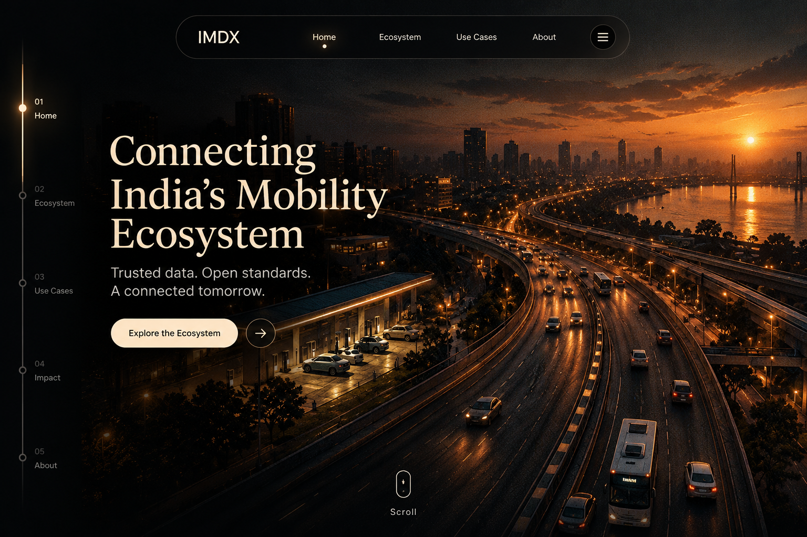
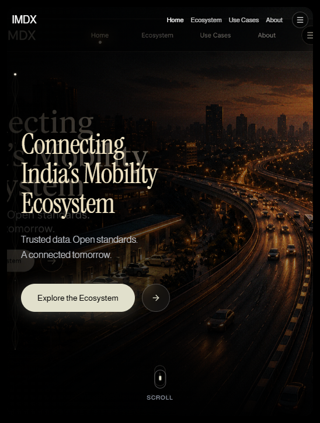

# IMDX

IMDX is a responsive single-page website for an India-focused mobility data
exchange initiative. It presents a cinematic visual identity and explains how
trusted, interoperable data can connect vehicle, battery, charging, fleet, and
urban-transport ecosystems.

## Preview





## Features

- Cinematic hero with a local mobility video and a static poster fallback.
- Responsive navigation with active-section highlighting and a dedicated menu.
- Sections for the IMDX ecosystem, benefits, mobility use cases, collaboration,
  and contact.
- Use-case detail modal with responsive overflow and keyboard closing.
- Presentation-only contact modal with native required/email validation.
- Scroll-linked orbital progress animation with reduced-motion support.
- Responsive layouts for desktop, tablet, and mobile breakpoints.
- Accessible dialog semantics, labels, Escape-to-close behavior, and body
  scroll locking.

The contact form is presentation-only. No backend or submission service is
configured, so it does not transmit or persist inquiries.

## Technology

- React 19
- TypeScript
- Vite 8
- Tailwind CSS 4
- Motion for React
- Lucide React
- Node test runner with `tsx`

## Project structure

```text
IMDX/
├── public/assets/
│   ├── aistudio/       # Hero video and visual assets
│   └── mobility/       # Mobility use-case artwork
├── screenshots/        # Desktop and mobile previews
├── src/
│   ├── components/     # Page sections, dialogs, navigation, and UI
│   ├── lib/            # Shared utilities
│   ├── App.tsx         # Single-page composition
│   ├── index.css       # Global styles and design tokens
│   └── imdx-logic.test.ts
├── index.html
├── package.json
├── tsconfig.json
└── vite.config.ts
```

## Setup

### Requirements

- Node.js 20 or newer
- npm 11 or Bun

Install with Bun:

```bash
bun install
```

The repository includes an existing `bun.lock`. With npm, use:

```bash
npm install --legacy-peer-deps
```

Start the development server:

```bash
npm run dev
```

Then open the local URL printed by Vite.

## Scripts

```bash
npm run dev       # Start the Vite development server
npm run build     # Type-check and create a production build
npm run lint      # Run ESLint
npm test          # Run the logic tests
npm run preview   # Serve the production build locally
```

## Implementation notes

- `@/*` resolves to `src/*` in both Vite and TypeScript.
- The hero video is loaded from `public/assets/aistudio/`.
- The poster image keeps the hero visually complete when autoplay or video
  decoding is unavailable.
- Navigation and animation updates avoid unnecessary React renders during
  scrolling.
- Generated directories such as `node_modules/`, `dist/`, and `.aistudio/` are
  excluded from the project submission.

## Validation

The current implementation has been checked with:

```bash
npm run lint
npm test
npm run build
```

The desktop and mobile previews are captures of the running application.
